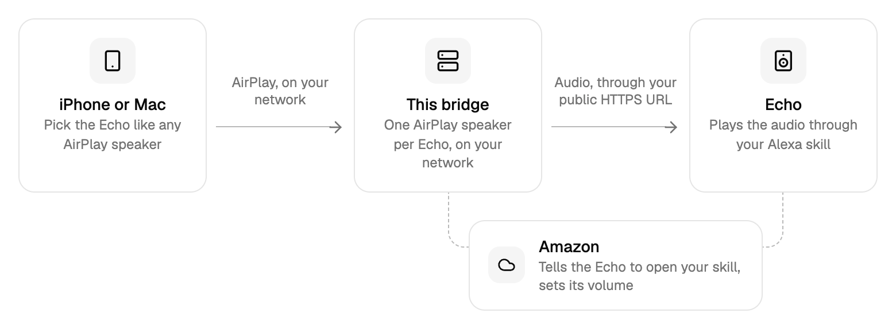

# Alexa via AirPlay

**Turn your Amazon Echos into AirPlay 2 speakers.**

Your Echos show up in the AirPlay menu of your iPhone, iPad and Mac, right next to your other speakers. Pick one or multiple, press play, and the music comes out of the Echo. No Bluetooth pairing, no Alexa app, no "Alexa, connect my phone".

## Features

- **Real AirPlay 2 speakers.** Every Echo you choose becomes its own AirPlay 2 receiver. It works from Control Center, from the lock screen, and from every app that can play to AirPlay: Apple Music, Spotify, Podcasts, Audible, YouTube, Safari, ...
- **Group them.** AirPlay 2 lets you pick several speakers at once: play to the kitchen and the bathroom Echo together, or add them to a group with your other AirPlay speakers. Be aware: Due to technical limitations it is not possible to achieve perfect synchronization.
- **It just follows along.** Start AirPlay and the Echo starts by itself. Change the volume on your phone and the Echo follows. Stop or switch speakers and the Echo stops.
- **Yours alone.** It runs on your own hardware. The stream is only served to your own Echos: short-lived signed links, only from your home's internet address, only while you play.

## How it works

<picture>
  <source media="(prefers-color-scheme: dark)" srcset=".github/assets/how-it-works-dark.png">
  
</picture>

A small Docker container on your home network runs one AirPlay 2 receiver per Echo. When you play to one, the bridge asks Amazon to open your own private Alexa skill on that Echo. The skill hands the Echo a short-lived link to the bridge's audio stream, and the Echo plays it. Echos only play audio from public HTTPS addresses, so the stream is reachable through a public URL of yours.

## Get started

1. **Make one port reachable over HTTPS**: a Cloudflare Tunnel takes about five minutes.
2. **Start the container** with `docker compose up -d --build`, or as a Portainer stack.
3. **Open the web UI** at `http://<your-server>:8098` and follow the four steps: public URL, Amazon sign-in, your Alexa skill, your Echos.

The **[setup guide](SETUP.md)** takes you through the rest of the setup.

## Limitations

- Due to technical limitations with alexa, the delay of the media device and actual audio output can vary quite a bit between 1-4 seconds, making it unsuitable for perfect audio synchronization between alexa devices and other speakers or video playback.
- Echo groups and stereo pairs from the Alexa app aren't supported; each Echo is its own AirPlay speaker.
- The bridge controls Echos through Amazon's unofficial web API, which can change without notice.

## For developers

```bash
pnpm install
pnpm check        # format check, type checks, lint, tests
pnpm build        # build the web UI into web/out
```

AirPlay and audio need Linux, Shairport Sync and ffmpeg, so they run in the container:

```bash
pnpm build
DATA_DIR=./data RUN_DIR=/tmp/avb MANAGE_RECEIVERS=false pnpm start
```

To work on the UI with hot reload, point the Next.js dev server at a running bridge:

```bash
UI_DEV_ORIGIN=http://localhost:3000 DATA_DIR=./data RUN_DIR=/tmp/avb MANAGE_RECEIVERS=false pnpm start
BRIDGE_URL=http://localhost:8098 pnpm dev:web
```

| Folder     | What's inside                                                                        |
| ---------- | ------------------------------------------------------------------------------------ |
| `src/`     | The bridge: AirPlay receivers, audio pipeline, Alexa control, public stream, LAN API |
| `test/`    | Tests (Node's test runner), mirroring `src/`                                         |
| `web/`     | The web UI                                                                           |
| `SETUP.md` | Setup guide, configuration reference, security model                                 |
