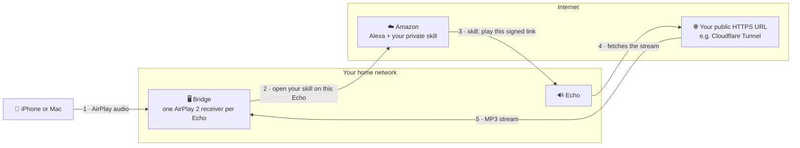

# Setup guide

This guide gets the bridge running and its web UI open. From there, the web UI walks you
through the rest and checks each step as you go.

You'll do three things here:

1. [Get a public HTTPS address](#step-1-get-a-public-https-address)
2. [Start the bridge](#step-2-start-the-bridge)
3. [Finish in the web UI](#step-3-finish-in-the-web-ui)

## Before you start

You need:

- [ ] **A machine with Docker** that's always on and on the same network as your iPhone or
      Mac: a Raspberry Pi 4/5, a small VM or anything else. The bridge uses a few percent
      of CPU and well under 100 MB of RAM. Linux is needed for host networking. On a Mac
      or Windows PC, use a Linux VM with bridged networking; Docker Desktop doesn't work.
- [ ] **A public HTTPS address**, for example through a Cloudflare Tunnel. (Any other
      HTTPS reverse proxy works too; see
      [Other ways to publish the port](#other-ways-to-publish-the-port).) This is where
      your Echos fetch the audio from, and no worries: nobody but your own Echos can play
      it.
- [ ] **The Amazon account your Echos belong to.** You'll also sign in to the free
      [Alexa developer console](https://developer.amazon.com/alexa/console/ask) with it.
      Registration takes just a few minutes.

Two things the machine must not have, because the bridge brings its own:

- No other AirPlay 2 receiver (Shairport Sync, NQPTP) or PTP service. It needs UDP ports
  319 and 320 for itself.
- No other mDNS responder (Avahi, or systemd-resolved with MulticastDNS enabled).

## How it works



1. You play to an Echo from your iPhone or Mac. The bridge receives the audio.
2. The bridge asks Amazon to open **your own private Alexa skill** on that Echo.
3. The skill answers with a link to the bridge's stream, signed and valid for 60 seconds.
4. The Echo fetches that link. Echos only play from public HTTPS addresses, so the link
   points to your public URL.
5. Your tunnel passes the request back to the bridge, which streams the audio as MP3.

## Step 1: Get a public HTTPS address

You'll create a Cloudflare Tunnel: a small program on your server that connects out to
Cloudflare, so your router needs no open ports.

1. In the [Cloudflare dashboard](https://dash.cloudflare.com), open **Zero Trust →
   Networks → Tunnels** and choose **Create a tunnel**. Pick **Cloudflared** and give it
   a name, e.g. `airplay`.
2. On the next screen, copy the **token**: the long string after `--token`, starting with
   `eyJ`. Keep it private.
3. Add a **public hostname**:
   - Subdomain: e.g. `airplay`, plus your domain
   - Service type: **HTTP**
   - URL: **`localhost:8099`**
4. On your server, start cloudflared with that token. Save this as `compose.yaml` in a
   new folder, e.g. `~/cloudflared`:

   ```yaml
   services:
     cloudflared:
       image: cloudflare/cloudflared:2026.10.1
       restart: unless-stopped
       network_mode: host
       command: tunnel --no-autoupdate run
       environment:
         TUNNEL_TOKEN: ${TUNNEL_TOKEN}
   ```

   Then, in that folder:

   ```bash
   echo "TUNNEL_TOKEN=<your token>" > .env
   docker compose up -d
   ```

   In Portainer, create a stack from the same file instead and add `TUNNEL_TOKEN` as an
   environment variable.

Your public address is now `https://airplay.<your domain>`. It won't work until the
bridge runs; that's the next step.

> [!IMPORTANT]
> **Use one subdomain level only**, like `airplay.example.com`. Cloudflare's free
> certificate doesn't cover `airplay.home.example.com`, and Amazon rejects addresses
> without a valid certificate.
>
> **Don't open the address before you've created it.** A "not found" answer gets cached
> for up to 30 minutes, by your router, your Echo and Amazon.

## Step 2: Start the bridge

On the same server:

```bash
git clone https://github.com/btreitz/alexa-via-airplay.git
cd alexa-via-airplay
echo "PUBLIC_BIND=127.0.0.1" > .env
docker compose up -d --build
```

`PUBLIC_BIND=127.0.0.1` keeps the stream port off your network, since only cloudflared on
the same machine needs it. The first build takes a few minutes.

**With Portainer:** create a stack from this Git repository (compose path
`compose.yaml`), add the environment variable `PUBLIC_BIND=127.0.0.1`, and deploy.

## Step 3: Finish in the web UI

Open **`http://<your server>:8098`** in your browser. The web UI walks you through four
steps:

| Step               | What you do                                                                                                                                  |
| ------------------ | -------------------------------------------------------------------------------------------------------------------------------------------- |
| **Public URL**     | Enter `https://airplay.<your domain>` and press Check. The bridge sends a request to itself through it.                                      |
| **Amazon account** | Pick your Amazon site and sign in, including two-step verification.                                                                          |
| **Alexa skill**    | Create your private skill in the Alexa developer console. The UI shows exactly what to click, and the two files to paste, with copy buttons. |
| **Echos**          | Turn on the Echos you want in AirPlay, press **Identify** on each, and play the test sound.                                                  |

Then open the AirPlay menu on your iPhone or Mac: your Echos are there. 🎉

> [!WARNING]
> The web UI has no login. Keep port 8098 on your home network and never publish it to
> the internet.

## Troubleshooting

Start with **Diagnostics** in the web UI: it shows the startup checks, the public URL
check and the last requests to the stream, each with the reason it was refused.

| Problem                             | What to check                                                                                                                        |
| ----------------------------------- | ------------------------------------------------------------------------------------------------------------------------------------ |
| The Echo doesn't show up in AirPlay | The startup checks in Diagnostics; whether your iPhone is on the same network (VLANs need mDNS forwarding).                          |
| The Echo says "there was a problem" | The public URL check; whether the skill code is current (paste it again after changing the URL or rotating the secret).              |
| The Echo doesn't start by itself    | The Amazon sign-in (sign in again if it expired); the invocation name in the skill must match the one in the web UI.                 |
| Refusals with `home-ip-mismatch`    | Your Echos reach the internet through another address (VPN, second line): turn off **Only serve this home's public IP** in Settings. |

---

## Reference

<details id="other-ways-to-publish-the-port">
<summary><strong>Other ways to publish the port</strong></summary>

Any reverse proxy with a valid certificate works: Nginx Proxy Manager, Caddy, Traefik,
Tailscale Funnel and others. Point a public hostname to `http://<bridge host>:8099`, turn
off response buffering (Nginx: `proxy_buffering off;`), and tell the bridge in `.env`
which header carries the real client address and which proxy may set it:

```bash
CLIENT_IP_HEADER=x-real-ip           # or x-forwarded-for
TRUSTED_PROXIES=192.168.1.10         # the proxy's address as the bridge sees it
```

If cloudflared runs on another machine, point the tunnel to `http://<bridge host>:8099`,
leave `PUBLIC_BIND` unset, and set `TRUSTED_PROXIES` to cloudflared's address.

</details>

<details>
<summary><strong>Configuration and ports</strong></summary>

The container uses host networking, so these are ports on your server. Change them in
`.env` (or the Portainer stack's environment variables) if they're taken;
[`.env.example`](.env.example) lists every option.

| Port         | Variable            | Purpose                               |
| ------------ | ------------------- | ------------------------------------- |
| 8098/tcp     | `UI_PORT`           | Web UI, home network only             |
| 8099/tcp     | `PUBLIC_PORT`       | Audio stream for your tunnel or proxy |
| 3456/tcp     | `ALEXA_PROXY_PORT`  | Amazon sign-in, only while signing in |
| 7000+/tcp    | `AIRPLAY_BASE_PORT` | AirPlay, one port per Echo            |
| 319, 320/udp |                     | AirPlay 2 timing                      |
| 5353/udp     |                     | Speaker discovery (mDNS)              |

</details>

<details>
<summary><strong>How the stream is protected</strong></summary>

The stream port answers only when all three checks pass, and every refusal gets the same
plain "not found":

1. **Signed, short-lived links.** Your skill signs each link with a secret only it and the
   bridge know. A link is valid for 60 seconds.
2. **Only your home.** Requests must come from your home's public IP address.
3. **Only while you play.** The link must belong to one of your Echos, and that Echo must
   be playing right now.

Keep the skill code private, since it contains the secret. If it leaks, rotate the secret
in Settings and paste the new code.

</details>
