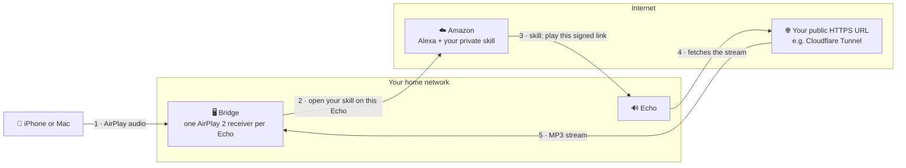

# Setup guide

This guide gets the bridge running and its web UI open. From there, the web UI walks you
through the rest and checks each step as you go.

Plan about 30 minutes. You'll do three things here:

1. [Get a public HTTPS address](#step-1-get-a-public-https-address) (about 10 minutes)
2. [Start the bridge](#step-2-start-the-bridge) (about 5 minutes)
3. [Finish in the web UI](#step-3-finish-in-the-web-ui) (about 15 minutes)

## Before you start

You need:

- [ ] **A Linux machine with Docker** that's always on and on the same network as your
      iPhone or Mac. A Raspberry Pi 4/5, a small VM or an LXC container is plenty: the
      bridge uses a few percent of CPU and well under 100 MB of RAM.
- [ ] **A domain on Cloudflare.** The free plan is fine. (Any other HTTPS reverse proxy
      works too; see [Other ways to publish the port](#other-ways-to-publish-the-port).)
- [ ] **The Amazon account your Echos belong to.** You'll also sign in to the free
      [Alexa developer console](https://developer.amazon.com/alexa/console/ask) with it.

Two things the Linux machine must not have, because the bridge brings its own:

- No other AirPlay 2 receiver (Shairport Sync, NQPTP) or PTP service. It needs UDP ports
  319 and 320 for itself.
- No other mDNS responder (Avahi, or systemd-resolved with MulticastDNS enabled).

Docker Desktop on macOS or Windows doesn't work: AirPlay discovery needs host networking.

## How it works



1. You play to an Echo from your iPhone or Mac. The bridge receives the audio.
2. The bridge asks Amazon to open **your own private Alexa skill** on that Echo, just as
   if you'd said "Alexa, open my sound bridge".
3. The skill answers with a link to the bridge's stream, signed and valid for 60 seconds.
4. The Echo fetches that link. Echos only play from public HTTPS addresses, so the link
   points to your public URL.
5. Your tunnel passes the request back to the bridge, which streams the audio as MP3.

From then on, the bridge also keeps the Echo's volume in line with your phone and stops
the Echo when you stop AirPlay.

## Step 1: Get a public HTTPS address

You'll create a Cloudflare Tunnel: a small program on your server that connects out to
Cloudflare, so your router needs no open ports.

1. In the [Cloudflare dashboard](https://dash.cloudflare.com), open **Zero Trust →
   Networks → Tunnels** and choose **Create a tunnel**. Pick **Cloudflared** and give it
   a name, e.g. `airplay`.
2. On the next screen, copy the **token**: the long string after `--token`, starting with
   `eyJ`. Keep it private.
3. Add a **public hostname**:
   - Subdomain: e.g. `airplay`, plus your domain
   - Service type: **HTTP**
   - URL: **`localhost:8099`**
4. On your server, start cloudflared with that token. Save this as `compose.yaml` in a
   new folder, e.g. `~/cloudflared`:

   ```yaml
   services:
     cloudflared:
       image: cloudflare/cloudflared:2026.10.1
       restart: unless-stopped
       network_mode: host
       command: tunnel --no-autoupdate run
       environment:
         TUNNEL_TOKEN: ${TUNNEL_TOKEN}
   ```

   Then, in that folder:

   ```bash
   echo "TUNNEL_TOKEN=<your token>" > .env
   docker compose up -d
   ```

   In Portainer, create a stack from the same file instead and add `TUNNEL_TOKEN` as an
   environment variable.

Your public address is now `https://airplay.<your domain>`. It won't work until the
bridge runs; that's the next step.

> [!IMPORTANT]
> **Use one subdomain level only**, like `airplay.example.com`. Cloudflare's free
> certificate doesn't cover `airplay.home.example.com`, and Amazon rejects addresses
> without a valid certificate.
>
> **Don't open the address before you've created it.** A "not found" answer gets cached
> for up to 30 minutes, by your router, your Echo and Amazon.

## Step 2: Start the bridge

On the same server:

```bash
git clone https://github.com/btreitz/alexa-via-airplay.git
cd alexa-via-airplay
echo "PUBLIC_BIND=127.0.0.1" > .env
docker compose up -d --build
```

`PUBLIC_BIND=127.0.0.1` keeps the stream port off your network, since only cloudflared on
the same machine needs it. The first build takes a few minutes.

**With Portainer:** create a stack from this Git repository (compose path
`compose.yaml`), add the environment variable `PUBLIC_BIND=127.0.0.1`, and deploy.
Portainer builds the image itself.

Check that it started:

```bash
docker compose logs --since 2m
```

You should see three passing checks (`host-network`, `ptp-ports`, `mdns`) and `ready`.

## Step 3: Finish in the web UI

Open **`http://<your server>:8098`** in your browser. The web UI walks you through four
steps:

| Step               | What you do                                                                                                                                  |
| ------------------ | -------------------------------------------------------------------------------------------------------------------------------------------- |
| **Public URL**     | Enter `https://airplay.<your domain>` and press Check. The bridge sends a request to itself through it.                                      |
| **Amazon account** | Pick your Amazon site and sign in, including two-step verification.                                                                          |
| **Alexa skill**    | Create your private skill in the Alexa developer console. The UI shows exactly what to click, and the two files to paste, with copy buttons. |
| **Echos**          | Turn on the Echos you want in AirPlay, press **Identify** on each, and play the test sound.                                                  |

Then open the AirPlay menu on your iPhone or Mac: your Echos are there. 🎉

> [!WARNING]
> The web UI has no login. Keep port 8098 on your home network and never publish it to
> the internet.

---

## Everyday use

- **Play to an Echo:** pick it in the AirPlay menu. It starts within a few seconds.
- **Several Echos at once:** pick several speakers in the AirPlay menu.
- **Volume:** follows your iPhone or Mac (switchable in Settings).
- **Pause or stop:** after the idle time (60 seconds by default), the Echo stops too.
- **"Alexa, stop"** pauses your iPhone or Mac. **"Alexa, resume"** plays again.

**Settings → Preset** sets how the bridge handles the delay:

| Preset            | Good for             | What it does                                                                               |
| ----------------- | -------------------- | ------------------------------------------------------------------------------------------ |
| **Low latency**   | Least delay          | Trims the Echo's buffer right away (one short skip) and keeps it connected for 10 minutes. |
| **Balanced**      | Music (default)      | Trims the buffer only during quiet moments, so nothing audible is skipped.                 |
| **Uninterrupted** | Podcasts, audiobooks | Never skips anything; the Echo stays about 2 seconds behind.                               |
| **Custom**        | Your own mix         | Set the idle time and catch-up yourself.                                                   |

## Updating

```bash
cd alexa-via-airplay
git pull
docker compose up -d --build
```

In Portainer, use **Pull and redeploy** on the stack. Your settings, Amazon sign-in and
signing secret live in the Docker volume `alexa-via-airplay_data` and survive updates.

**Moving to another server:** in the web UI, choose **Settings → Export settings**. On the
new server, import the file on the first page of the setup ("Already have a settings
file?"). Then sign in to Amazon again; the sign-in isn't part of the file.

## Troubleshooting

Start with **Diagnostics** in the web UI: it shows the startup checks, the public URL
check and the last requests to the stream, each with the reason it was refused.

| Problem                                         | What to check                                                                                                                        |
| ----------------------------------------------- | ------------------------------------------------------------------------------------------------------------------------------------ |
| The Echo doesn't show up in AirPlay             | The startup checks in Diagnostics; whether your iPhone is on the same network (VLANs need mDNS forwarding).                          |
| The Echo says "there was a problem"             | The public URL check; whether the skill code is current (re-paste it after changing the URL or rotating the secret).                 |
| The Echo doesn't start by itself                | The Amazon sign-in (sign in again if it expired); the invocation name in the skill must match the one in the web UI.                 |
| The address isn't found right after creating it | Wait up to 30 minutes: a cached "not found".                                                                                         |
| Refusals with `home-ip-mismatch`                | Your Echos reach the internet through another address (VPN, second line): turn off **Only serve this home's public IP** in Settings. |

For logs, `docker compose logs --since 5m` shows the last five minutes.

---

## Reference

<details>
<summary><strong>Configuration</strong></summary>

Everything is optional and goes into `.env` (or the Portainer stack's environment
variables). Settings you change in the web UI are stored in the data volume instead.

| Variable              | Default                                | Purpose                                                                       |
| --------------------- | -------------------------------------- | ----------------------------------------------------------------------------- |
| `PUBLIC_BIND`         | `0.0.0.0`                              | Where the stream port listens. `127.0.0.1` with cloudflared on the same host. |
| `PUBLIC_PORT`         | `8099`                                 | The stream port your tunnel or proxy points to.                               |
| `PUBLIC_BASE_URL`     |                                        | Fixes the public URL instead of entering it in the web UI.                    |
| `UI_PORT`, `UI_BIND`  | `8098`, `0.0.0.0`                      | The web UI. Never publish it.                                                 |
| `ALEXA_PROXY_PORT`    | `3456`                                 | The Amazon sign-in page, used only while signing in.                          |
| `AIRPLAY_BASE_PORT`   | `7000`                                 | The first AirPlay port; each Echo takes the next free one.                    |
| `CLIENT_IP_HEADER`    | `cf-connecting-ip`                     | Header with the real client address, believed only from `TRUSTED_PROXIES`.    |
| `TRUSTED_PROXIES`     | `127.0.0.1,::1`                        | Proxies allowed to set that header.                                           |
| `PUBLIC_IP_TRACE_URL` | `https://cloudflare.com/cdn-cgi/trace` | Where the bridge looks up your home's public address.                         |
| `PUBLIC_IP_V6_PREFIX` | `64`                                   | IPv6 clients must share this prefix with your home.                           |
| `AVAHI_INTERFACES`    | default route's interface              | Network interfaces the AirPlay speakers are announced on.                     |
| `LOG_LEVEL`           | `info`                                 | `debug`, `info`, `warn` or `error`.                                           |

[`.env.example`](.env.example) lists them all with explanations.

</details>

<details>
<summary><strong>Ports</strong></summary>

The container uses host networking, so these are ports on your server:

| Port         | Purpose                               | Reachable from               |
| ------------ | ------------------------------------- | ---------------------------- |
| 8098/tcp     | Web UI and API                        | Your home network only       |
| 8099/tcp     | Audio stream (`/play.mp3`)            | Your tunnel or reverse proxy |
| 3456/tcp     | Amazon sign-in, only while signing in | Your home network            |
| 7000+/tcp    | AirPlay, one port per Echo            | Your home network            |
| 319, 320/udp | AirPlay 2 timing (NQPTP)              | Your home network            |
| 5353/udp     | Speaker discovery (mDNS)              | Your home network            |

</details>

<details id="other-ways-to-publish-the-port">
<summary><strong>Other ways to publish the port</strong></summary>

Any reverse proxy with a valid certificate works: Nginx Proxy Manager, Caddy, Traefik,
Tailscale Funnel and others. Point a public hostname to `http://<bridge host>:8099`, turn
off response buffering (Nginx: `proxy_buffering off;`), and tell the bridge which header
carries the real client address and which proxy may set it:

```bash
CLIENT_IP_HEADER=x-real-ip           # or x-forwarded-for
TRUSTED_PROXIES=192.168.1.10         # the proxy's address as the bridge sees it
```

If cloudflared runs on another machine, point the tunnel's hostname to
`http://<bridge host>:8099`, leave `PUBLIC_BIND` unset, and set `TRUSTED_PROXIES` to
cloudflared's address. If the port is forwarded directly without a proxy, use
`CLIENT_IP_HEADER=none`.

Cloudflare's quick tunnels (`trycloudflare.com`) don't work: their address changes on
every start.

</details>

<details>
<summary><strong>How the stream is protected</strong></summary>

The stream port answers exactly one path, `/play.mp3`, and only when all three checks
pass. Every refusal gets the same plain "not found".

1. **Signed, short-lived links.** Your skill signs each link with HMAC-SHA256 and a secret
   that only the bridge and your skill know. A link is valid for 60 seconds. The secret is
   never part of a URL and never logged.
2. **Only your home.** The bridge looks up your home's public IPv4 and IPv6 every few
   minutes and only serves requests from the same IPv4 address or the same IPv6 /64.
   While it doesn't know its address, it serves nobody.
3. **Only while you play.** The link must belong to one of your selected Echos, and that
   Echo must be in an active AirPlay session or have been started by the bridge seconds
   ago.

The skill also reports playback events (started, stopped, "Alexa, stop") to the same path.
These reports are signed over a different message, so a stream link can't be used as a
report or the other way round, and each report is accepted once.

What this doesn't cover:

- Someone who has your skill code (which contains the secret) **and** is on your home
  network during playback. Keep the skill code private; if it leaks, rotate the secret in
  Settings and paste the new code.
- **CGNAT:** if your provider shares one public IPv4 address among many customers, the
  home check lets in everyone behind it. The other two checks still apply.
- The web UI on port 8098 has no login. Keep it on your home network.

</details>

<details>
<summary><strong>Limits</strong></summary>

- The Echo plays about 1.5–2 seconds behind your phone: good for music and spoken word,
  not for video.
- In an AirPlay group with HomePods or other AirPlay speakers, the Echo plays slightly
  behind them.
- Echo groups and stereo pairs from the Alexa app aren't supported; each Echo is its own
  speaker.
- Amazon's web API is unofficial and can change at any time. Sign-in or commands may
  break until the bridge is updated.
- Cloudflare's terms limit using its network mainly for audio and video. A few personal
  streams are unlikely to matter, which is why the tunnel is a recommendation, not a
  requirement.

</details>
